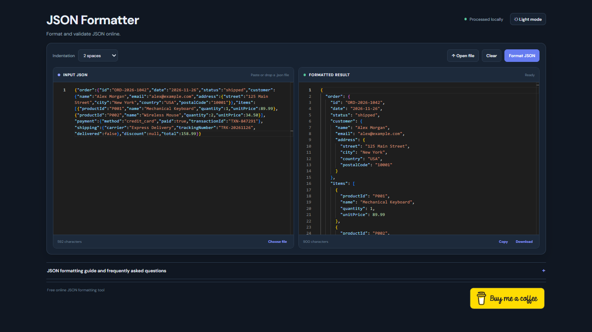

# JSON Formatter

A browser-based tool for formatting and validating JSON. It provides an editable input pane and a formatted, read-only output pane. JSON parsing and formatting take place in the browser.

<p align="center">
  
  
  
  
</p>

## Preview

<p align="center">
  
</p>

## Features

- Automatically format valid JSON after a short pause
- Validate and format on demand, with parsing errors for invalid input
- Edit JSON with Monaco Editor syntax highlighting and a read-only output pane
- Import local `.json` files using the file picker or drag and drop
- Copy formatted output or download it as `formatted.json`
- Choose 2-space, 4-space or tab indentation
- Switch between dark and light themes, with the preference stored in local storage
- Process JSON locally in the browser

## Technology stack

| Technology | Role |
|---|---|
| React 19 | UI components and application state |
| TypeScript 5.9 | Application types and compile-time checks |
| Vite 8 | Development server and production bundler |
| Monaco Editor | JSON editing and syntax highlighting |
| CSS | Layout, responsive styling and themes |

## Project structure

```text
json-formatter/
├── public/
│   ├── buy-me-a-coffee.png
│   └── favicon.svg
├── screenshots/
│   └── json-formatter.png
├── src/
│   ├── components/
│   │   ├── EditorPane.tsx
│   │   └── Toolbar.tsx
│   ├── App.tsx
│   ├── main.tsx
│   └── styles.css
├── index.html
├── package.json
├── tsconfig.json
├── tsconfig.app.json
├── tsconfig.node.json
└── vite.config.ts
```

## Requirements

- Node.js 22 or later
- npm

## Installation

```bash
git clone https://github.com/YOUR_USERNAME/json-formatter.git
cd json-formatter
npm install
```

Start the development server:

```bash
npm run dev
```

On Windows PowerShell, use `npm.cmd` if the execution policy blocks the npm PowerShell shim:

```powershell
npm.cmd install
npm run build
npm.cmd run dev
```

## Development note

AI tools were used to assist with parts of the implementation, while the project also served as a practical study of TypeScript.
